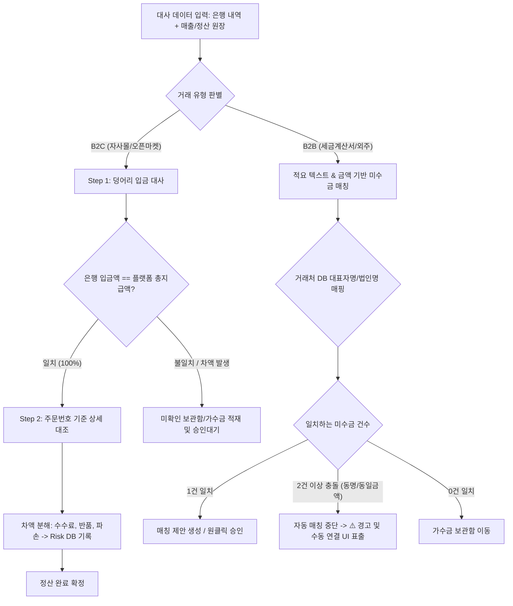

# [PRD] 매출/정산 및 입금 대사 자동화 시스템
(Multi-channel Revenue, Settlement & Deposit Reconciliation System)

---

## 1. 문서 및 제품 개요 (Product Overview)

### 1.1. 개요 및 배경
본 시스템은 다채널(자사몰, 오픈마켓, B2B 도매/외주) 매출 데이터와 은행 계좌 실입금 내역(Bank Statements)을 교차 검증(Reconciliation)하는 자금/재무팀 전용 통합 자동화 도구입니다. 

기존의 수작업 엑셀 대조 업무에서 발생하는 인적 오류, 입금 누락, 수수료 오정산, 미확인 입금(가수금) 누적 문제를 해결하기 위해, **룰 기반 매칭 엔진**과 **Supabase 기반 엄격한 내부통제(RBAC/RLS)**를 적용하여 실시간 미수금(AR) 추적 및 경영진 리포팅 체계를 제공합니다.

### 1.2. 핵심 목표
1. **입금 대사 자동화율 80% 이상 달성**: B2C 2-Step 매칭 및 B2B 지능형 매핑을 통한 수작업 공수 최소화.
2. **원천적인 데이터 보안 및 내부통제**: Supabase RLS 기반 역할별 접근 통제로 미정산 가수금 및 민감 재무 데이터 유출 방지.
3. **손익 누수(Risk) 가시화**: 플랫폼별 차감 수수료, 반품, 파손 등 리스크 요소를 원천 거래 레벨까지 드릴다운(Drill-down) 추적.
4. **회계 사고 방지**: 대표자명 불일치, 동명/동일 금액 중복 충돌 시 자동 중단 및 자금 관리자 수동 검증 워크플로우 보장.

---

## 2. 사용자 역할 및 권한 체계 (Authentication & RBAC / RLS)

### 2.1. 인증 방식
* **인증 인프라**: Supabase Auth (이메일/비밀번호 기반 로그인).
* **가입 및 초대**: 사내 재무/자금 시스템 특성상 자가 회원가입(Public Signup)은 비활성화하고, 관리자 초대(Invite-only) 방식으로 운영.

### 2.2. 역할 정의 (Roles)
`auth.users`와 1:1 매핑되는 `public.profiles` 테이블의 `role` 컬럼으로 제어합니다.

| 역할 (Role) | 대상 | 권한 범위 |
| :--- | :--- | :--- |
| **`admin`**<br>(자금/재무 관리자) | 자금팀, 재무기획팀 | • 전체 데이터 CRUD 권한<br>• 원천 엑셀/은행 내역 업로드 및 대사(Reconcile) 실행<br>• 미확인 가수금 조회/승인 및 수동 매칭/분개 처리<br>• 거래처 마스터(대표자명 매핑) 관리 |
| **`executive`**<br>(경영진) | 대표이사, CFO, 사업본부장 | • 전사 대시보드 및 리스크/가수금/미수금 전체 읽기(Read-Only)<br>• 기간별/채널별 수익성 리포트 및 자금 흐름 추이 열람 |
| **`viewer`**<br>(영업 관리자) | 영업팀, 채널별 MD | • 본인 담당 채널/거래처의 확정 매출 및 정상 확정된 미수금(AR)만 조회 가능<br>• **미정산 가수금(`suspense_amounts`) 및 타 채널 원천 데이터 접근 원천 차단** |

### 2.3. Supabase RLS (Row Level Security) 정책 설계
가장 민감한 미확인 보류금액(가수금) 테이블인 `suspense_amounts`에는 강력한 RLS 정책을 적용하여 영업 부서로의 데이터 노출을 DB 엔진 레벨에서 원천 차단합니다.

```sql
-- 1. profiles 테이블 생성 및 role enum 정의
CREATE TYPE user_role AS ENUM ('admin', 'executive', 'viewer');

CREATE TABLE public.profiles (
  id UUID PRIMARY KEY REFERENCES auth.users(id) ON DELETE CASCADE,
  email TEXT NOT NULL,
  role user_role NOT NULL DEFAULT 'viewer',
  channel_scope TEXT, -- viewer인 경우 특정 채널만 제한 (예: 'SMARTSTORE', 'COUPANG', 'B2B')
  created_at TIMESTAMPTZ DEFAULT now()
);

-- 2. 가수금(미확인 보관함) 테이블
CREATE TABLE public.suspense_amounts (
  id UUID PRIMARY KEY DEFAULT gen_random_uuid(),
  bank_statement_id UUID REFERENCES public.bank_statements(id),
  amount NUMERIC(15, 2) NOT NULL,
  sender_name TEXT NOT NULL,
  reason TEXT NOT NULL, -- 'UNMATCHED_AMOUNT', 'DUPLICATE_CANDIDATES', 'UNKNOWN_SENDER'
  status TEXT NOT NULL DEFAULT 'PENDING', -- 'PENDING', 'RESOLVED', 'REFUNDED'
  conflict_count INT DEFAULT 0,
  resolved_by UUID REFERENCES public.profiles(id),
  resolved_at TIMESTAMPTZ,
  created_at TIMESTAMPTZ DEFAULT now()
);

-- 3. RLS 활성화
ALTER TABLE public.suspense_amounts ENABLE ROW LEVEL SECURITY;

-- 4. RLS 정책: admin과 executive만 가수금 테이블 조회 가능
CREATE POLICY "Allow admin and executive to read suspense_amounts"
ON public.suspense_amounts
FOR SELECT
TO authenticated
USING (
  EXISTS (
    SELECT 1 FROM public.profiles
    WHERE public.profiles.id = auth.uid()
      AND public.profiles.role IN ('admin', 'executive')
  )
);

-- 5. RLS 정책: admin만 가수금 수정/처리 가능
CREATE POLICY "Allow only admin to update suspense_amounts"
ON public.suspense_amounts
FOR UPDATE
TO authenticated
USING (
  EXISTS (
    SELECT 1 FROM public.profiles
    WHERE public.profiles.id = auth.uid()
      AND public.profiles.role = 'admin'
  )
)
WITH CHECK (
  EXISTS (
    SELECT 1 FROM public.profiles
    WHERE public.profiles.id = auth.uid()
      AND public.profiles.role = 'admin'
  )
);
```

---

## 3. 핵심 대시보드 (Key Metrics & Reporting)

```
┌────────────────────────────────────────────────────────────────────────┐
│  [헤더] 기간 필터 (월/분기/연도) | 채널 선택 (전체, 자사몰, 스마트스토어, B2B) │
├────────────────────────────────────────────────────────────────────────┤
│  [KPI 카드]                                                            │
│  - 총 발생 매출액 : ₩ 452,000,000      - 누적 입금 완료액 : ₩ 388,500,000 │
│  - 미수금(AR) 총액 : ₩ 63,500,000      - 미확인 가수금 : ₩ 3,200,000 (⚠️)│
├──────────────────────────────────────┬─────────────────────────────────┤
│  [미수금(AR) 연령 분석표]            │  [리스크 비중 (Pie Chart)]       │
│  - 정상 채권 (+30일 이내): 82%       │  - 플랫폼 수수료 : 64%           │
│  - 악성 연체 (+30일 초과): 18% (RED) │  - 반품 환불액   : 26%           │
│                                      │  - 파손/기타 손실 : 10%           │
├──────────────────────────────────────┴─────────────────────────────────┤
│  [리스크 발생 추이 (Line Chart)] & [드릴다운 상세 원천 데이터 테이블]     │
│  * 특정 일자/리스크 항목 클릭 시 원천 거래(날짜, 거래처, 금액, 사유) 표출 │
└────────────────────────────────────────────────────────────────────────┘
```

### 3.1. 가용 자금 흐름 요약 (Cashflow Summary)
* **총 발생 매출액 vs 누적 입금 완료액**: 채널별/기간별 교차 집계.
* **실시간 대사율(Reconciliation Rate)**: `(정산 완료 입금액 / 총 매출 발생액) * 100`

### 3.2. 미수금(AR) 현황 및 Aging Table
* **정산 예정일 산출 공식**: 매출 인식일(세금계산서 발행일 또는 판매 확정일) 기준 `+30일`.
* **상태 구분 배지**:
  * 🟢 **정상 채권 (Normal)**: 정산 예정일까지 잔여 일수가 남은 건.
  * 🔴 **기한 초과 악성 채권 (Overdue / Critical)**: 기준일 경과 건. 붉은색 경고 하이라이트 및 경과 일수(+N일) 표기.

### 3.3. 리스크 시각화 (Risk Visualization UI)
* **비중 분석 (Pie Chart)**:
  * 총 차감액 중 **플랫폼 수수료(Platform Fee)**, **반품(Refund)**, **파손/배송사고(Damaged Loss)**의 점유율 시각화.
* **시계열 추이 분석 (Line Chart)**:
  * 주차(Weekly) 및 월별(Monthly) 리스크 추이 그래프를 통해 특정 프로모션 기간의 반품 급증이나 수수료율 인상 징후 탐지.
* **상호작용 드릴다운 (Interactive Drill-down)**:
  * 차트의 특정 파이 조각이나 라인 포인트를 클릭하면 화면 하단에 **해당 리스크를 유발한 원천 거래 레코드(주문일시, 채널/거래처명, 주문번호, 차감액, 상세사유)**가 필터링되어 즉시 출력.

---

## 4. 데이터 대사 엔진 (Data Matching & Reconciliation Logic)

채널 특성에 따라 B2C와 B2B 프로세스를 이원화하여 처리합니다.



### 4.1. B2C (자사몰/오픈마켓) : 2-Step 매칭
1. **1단계: 덩어리 금액 대조 (Lump-sum Matching)**
   * **대조 대상**: 통장 실입금 내역(입금자명 + 금액) ↔ 플랫폼 정산 확정 엑셀(플랫폼명 + 총 지급액).
   * **검증 규칙**: 1원 단위까지 100% 일치해야 통과.
   * **예외 처리**: 금액 불일치 시 일괄 확정을 차단하고 전체 또는 차액을 `suspense_amounts`로 이관하여 관리자 검토 대기.
2. **2단계: 주문번호 기준 상세 내역 분해 매칭 (Detail Item Matching)**
   * **대조 대상**: 정산 엑셀 내 주문번호(`order_key`) ↔ 최초 ERP/쇼핑몰 주문 원장.
   * **차액 분류**: 결제금액과 정산금액 간의 차이를 계산하여 다음 카테고리로 자동 라벨링:
     * `FEE`: 플랫폼 정산 수수료, PG 수수료
     * `RETURN`: 고객 단순변심/취소 환불액
     * `DAMAGE`: 배송 파손/분실 보상 차감액
   * 분류된 데이터는 `risk_records` 테이블에 적재되어 리스크 대시보드로 연동.

### 4.2. B2B (세금계산서/도매 거래) : 텍스트 + 금액 매칭
* 세금계산서 청구 금액과 은행 입금액, 그리고 통장 적요란에 기재된 텍스트를 대조하여 미수금 차감 매칭.

---

## 5. 예외 처리 및 수동 연결 워크플로우 (Edge Cases & Exception Handling)

회계 감사의 투명성을 확보하고 자금 오인식을 차단하기 위한 핵심 예외 처리 기능입니다.

### 5.1. 대표자명 교차 매칭 (B2B 적요 불일치 해결)
* **문제 상황**: 법인 거래처 '주식회사 알파'로 계산서를 발행했으나, 통장 적요에는 대표이사 개인명인 '홍길동'으로 입금되는 사례 빈번.
* **해결 로직**:
  * `business_partners` 테이블에 `company_name`(법인명)과 `ceo_name`(대표자명)을 사전 맵핑.
  * 은행 적요에 법인명이 없더라도 `ceo_name`과 일치하고, 해당 거래처의 미수금 청구액과 입금액이 일치하면 시스템이 **"대표자명 일치(추정 거래처: 주식회사 알파)"** 플래그를 붙여 매칭 제안.

### 5.2. 동명/동일 금액 충돌 감지 및 수동 연결 UI (N건 중복 충돌)
* **문제 상황**: 동명이인(예: '김철수') 거래처 2곳에 각각 5,000,000원의 청구 건이 존재하는 상태에서 5,000,000원이 입금된 경우, 임의 매칭 시 심각한 분개 왜곡 발생.
* **시스템 제어**:
  1. 조건 충족 후보가 2건 이상(`count >= 2`) 발견되는 즉시 **자동 매칭을 즉각 중단(HALT)**.
  2. 해당 입금 내역을 `suspense_amounts`로 이동시키고 사유를 `DUPLICATE_CANDIDATES`로 지정.
  3. UI 상에 ⚠️ **`동일 명의 거래처 [N]건 존재 (조회 및 수동 연결)`** 경고 배지 및 버튼 렌더링.
  4. 자금 관리자(`admin`)가 버튼 클릭 시 모달 팝업 오픈:
     * 후보 거래처 N개의 상세 정보(사업자등록번호, 최근 거래일, 세금계산서 발행번호, 미수금 내역) 비교 뷰 제공.
     * 라디오 버튼으로 1건을 선택하여 `[수동 연결 확정]` 클릭 시, 해당 거래처의 미수금과 상계 처리하고 대사 완료(`RECONCILED`) 상태로 전이.

---

## 6. 데이터베이스 테이블 스키마 설계 (Database Schema)

```
┌────────────────────────┐       1:N       ┌────────────────────────┐
│   business_partners    │────────────────<│     sales_records      │
│  (거래처 마스터 정보)  │                 │   (매출 원장 및 미수금)│
└────────────────────────┘                 └────────────────────────┘
            │                                           │
            │ 1:N                                       │ 1:1 or 1:N
            v                                           v
┌────────────────────────┐       1:1       ┌────────────────────────┐
│    bank_statements     │─────────────────│     reconciliations    │
│   (은행 계좌 거래내역) │                 │      (대사 결과 테이블) │
└────────────────────────┘                 └────────────────────────┘
            │                                           │
            │ 1:1                                       │ 1:N
            v                                           v
┌────────────────────────┐                 ┌────────────────────────┐
│    suspense_amounts    │                 │      risk_records      │
│   (미확인 가수금 보관함)│                 │   (수수료/반품/손실 원장)│
└────────────────────────┘                 └────────────────────────┘
```

### 6.1. 테이블 상세 정의

#### 1) `business_partners` (거래처 마스터)
* `id` (UUID, PK)
* `company_name` (VARCHAR): 법인/상호명
* `business_number` (VARCHAR): 사업자등록번호
* `ceo_name` (VARCHAR): 대표자 성명 (교차 대조 키)
* `channel_type` (VARCHAR): `B2B`, `SMARTSTORE`, `COUPANG`, `OWN_MALL` 등

#### 2) `sales_records` (매출 원장 및 청구 내역)
* `id` (UUID, PK)
* `partner_id` (UUID, FK -> `business_partners.id`)
* `order_key` (VARCHAR): 쇼핑몰 주문번호 또는 세금계산서 승인번호
* `sales_date` (DATE): 매출 인식일
* `due_date` (DATE): 정산 예정일 (기본값: `sales_date + INTERVAL '30 days'`)
* `gross_amount` (NUMERIC): 총 매출 청구액
* `status` (VARCHAR): `UNPAID`(미수), `PARTIAL`(부분입금), `PAID`(정산완료), `OVERDUE`(연체)

#### 3) `bank_statements` (은행 계좌 입금 원장)
* `id` (UUID, PK)
* `transaction_date` (TIMESTAMPTZ): 은행 입금 일시
* `amount` (NUMERIC): 입금액
* `sender_name` (VARCHAR): 통장 표시 적요/입금자명
* `bank_name` (VARCHAR): 입금 은행
* `account_number` (VARCHAR): 입금 계좌번호
* `reconciliation_status` (VARCHAR): `UNMATCHED`, `MATCHED`, `SUSPENSE`

#### 4) `suspense_amounts` (미확인 가수금 보관함)
* `id` (UUID, PK)
* `bank_statement_id` (UUID, FK -> `bank_statements.id`)
* `amount` (NUMERIC): 보류/불일치 금액
* `sender_name` (VARCHAR): 입금자명
* `reason`: `UNMATCHED_AMOUNT`, `DUPLICATE_CANDIDATES`, `UNKNOWN_SENDER`
* `status`: `PENDING`, `RESOLVED`, `REFUNDED`
* `candidate_partner_ids` (JSONB): 중복 충돌 시 매핑된 거래처 ID 배열

#### 5) `reconciliations` (대사 완료 내역)
* `id` (UUID, PK)
* `sales_record_id` (UUID, FK -> `sales_records.id`)
* `bank_statement_id` (UUID, FK -> `bank_statements.id`)
* `matched_type` (VARCHAR): `AUTO_B2C_2STEP`, `AUTO_B2B_EXACT`, `AUTO_B2B_CEO_ALIAS`, `MANUAL_ADMIN`
* `settled_amount` (NUMERIC): 최종 상계 처리 금액
* `reconciled_by` (UUID, FK -> `profiles.id`): 처리자 (자동인 경우 SYSTEM)
* `reconciled_at` (TIMESTAMPTZ)

#### 6) `risk_records` (수수료 및 리스크 분석 내역)
* `id` (UUID, PK)
* `reconciliation_id` (UUID, FK -> `reconciliations.id`)
* `order_key` (VARCHAR): 원천 주문 식별자
* `risk_category` (VARCHAR): `FEE`(수수료), `RETURN`(반품), `DAMAGE`(파손/배송사고)
* `amount` (NUMERIC): 차감 손실 금액
* `description` (TEXT): 상세 사유

---

## 7. 주요 UI 화면 설계 (Screen Layouts & UI Specifications)

### 7.1. 화면 목록
1. **대시보드 (`/dashboard`)**: KPI 카드, 가용 자금 현황, AR Aging 표, 리스크 파이/라인 차트.
2. **입금 대사 워크스페이스 (`/reconciliation`)**:
   * 은행 데이터 / 매출 엑셀 드래그 앤 드롭 업로더
   * 자동 대사 실행 버튼 및 2-Step 매칭 프로그레스 바
   * 추천 매칭 목록 및 원클릭 승인 리스트
3. **가수금 관리함 (`/suspense`)** *(Admin 전용)*:
   * 미확인 입금 건 필터링 및 통계
   * ⚠️ 중복 충돌 건 수동 매칭 모달 팝업
4. **거래처 관리 (`/partners`)**: 법인명 - 대표자명 매핑 관리, 채널별 계약 수수료율 설정.

---

## 8. 비기능적 요구사항 (Non-Functional Requirements)

1. **대용량 파일 처리 성능**:
   * 월 최대 50,000건의 주문 정산 엑셀 파일 파싱 시 15초 이내 메모리 로딩 완료.
   * 백그라운드 워커를 통한 배치 대사 처리 및 웹소켓(Supabase Realtime) 기반 진행률 알림.
2. **데이터 무결성(Audit Trail)**:
   * 모든 수동 매칭 및 가수금 처리 건은 처리한 관리자 ID(`profiles.id`), 처리 시각, 처리 사유를 Audit Log로 영구 보존.
3. **브라우저 호환성**: 최신 Chrome, Edge, Safari 완벽 지원.

---

## 9. 단계별 개발 로드맵 (Milestones)

* **Phase 1: 기반 인프라 & 데이터 모델링 (1~2주차)**
  * Supabase 프로젝트 세팅, Auth, Profiles, Schema 구축 및 RLS 적용
  * 엑셀/CSV 데이터 파서(B2C 정산서, 은행 계좌 입금 원장) 구현
* **Phase 2: 매칭 엔진 및 핵심 대사 기능 구현 (3~4주차)**
  * B2C 2-Step 대사 알고리즘 개발 (총액 대사 ➔ 주문키 세부 대사 ➔ 리스크 DB 분류)
  * B2B 텍스트 + 대표자명 교차 매칭 알고리즘 구현
* **Phase 3: 예외 처리 UI 및 권한 통제 (5주차)**
  * 동명/동일 금액 충돌 감지 및 수동 분개 팝업 모달 구현
  * 미확인 가수금(`suspense_amounts`) 관리 탭 및 RLS 권한 차단 검증
* **Phase 4: 대시보드 리포팅 & 경영진 뷰 완성 (6주차)**
  * 미수금 Aging(연령) 분석 및 +30일 초과 악성 채권 하이라이트 UI
  * Chart.js / Recharts 기반 리스크 파이/라인 차트 및 인터랙티브 드릴다운 연동
